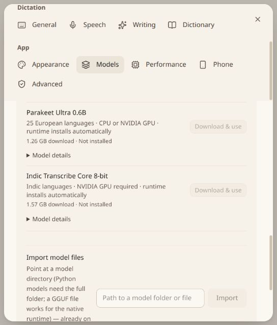

# Additional speech model download setup

Implemented `Download & use` for Parakeet Ultra and Indic Transcribe 8-bit, with runtime-first setup, pinned manifests and dedicated local adapters. Both integrations are experimental. The desktop development binary and production frontend build succeeded. No release or new runtime-pack assets were published.

## Verified

- Rust library suite: 697 passed, 18 ignored. The final bitsandbytes health-check change was followed by its focused passing runtime-health test.
- Frontend suite: all 411 tests passed after updating the former unavailable-model expectation. ESLint passed; the production build retains its existing bundle-size warning.
- Python model-free suite: 58 passed, including six new integrity, language, cancellation and decoder-boundary checks. Those six passed again after the final Indic token-limit guard.
- Runtime-pack builder suite: 10 passed. The release matrix now contains 20 configurations; the two additional entries are Linux/Windows x64 Indic CUDA 13. Both dependency locks resolved successfully.
- Parakeet checkpoint header inspection: no missing tensor names or mismatched shapes against Transformers 5.15.1's full `ParakeetForTDT` graph. The only extra tensors are the six optional `vad_head.*` parameters. This checks architecture compatibility, not recognition quality.
- Indic frontend numerical comparison against the pinned upstream `feature_extraction_indic_canary.py`: 8,001, 16,000, 32,123 and 480,000 sample inputs passed `torch.testing.assert_close(rtol=1e-5, atol=1e-5)`. The reference's torchaudio import was stubbed for this comparison; no resampling was invoked because inputs were already mono 16 kHz. The checkpoint's real mel/window buffers were used.
- On the local RTX 2050, the exact upstream Indic custom class, reduced to one encoder/decoder layer for the probe, successfully saved/loaded local synthetic weights and generated tokens on CUDA with 19 `Linear8bitLt` layers. This used torch 2.13.0+cu130, transformers 5.15.1 and bitsandbytes 0.50.2. It proves the custom graph's CUDA/int8 execution path, not the full checkpoint's memory fit or speech accuracy.
- The browser preview shows both new download controls. Airplane mode correctly disables them. The screenshot below uses fallback browser hardware/model state, not native inventory.

## Unverified

Full checkpoint downloads did not complete: the test transfer ended with a connection reset, leaving a partial Parakeet download and an incomplete Indic weight file in an isolated cache. Neither was installed into the app's model directories or used for transcription. Full-size local loading, real transcription, accuracy, latency, peak memory, CPU execution and clean packaged runtime installation remain unverified.

The initial attempt to prepare a separate torch/torchaudio 2.11 environment hit a dependency download timeout. The shipped profile instead retains torch 2.13 and consumes Reflow's existing 16 kHz audio without torchaudio. Optional bitsandbytes/sentencepiece packages were installed into an isolated probe environment, with the existing speech environment on the probe's module search path. The active app runtime and settings were not replaced. This was not a clean installation of the complete Indic lock.

Published installers need matching new Indic runtime packs and an embedded catalog produced by the existing release workflow. The checked-in catalog remains empty by design; development builds use the pinned development installer. No claim is made that the new packs have passed native distribution acceptance.

Restart the rebuilt desktop development app to load the new Rust manifests. Under Settings → Models, turn off Airplane mode if enabled, then choose Download & use. Dependencies are prepared before weights; Indic requires a compatible NVIDIA GPU and the managed CUDA 13 profile on Linux/Windows x64.
